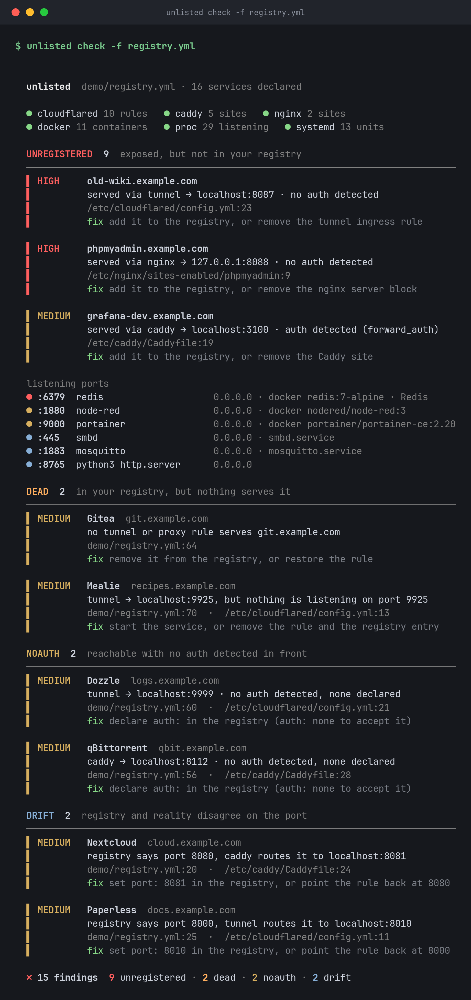

# unlisted

[](https://github.com/kd-011/unlisted/actions/workflows/ci.yml)

Compares the services you say you run with what your machine actually exposes, across your tunnel, reverse proxy, Docker and listening sockets, and reports the gaps.



*The output above is real: `unlisted check -f demo/registry.yml --config-root demo`. Plain text version in [docs/demo.txt](docs/demo.txt).*

Homelabs rot in two directions. Things get exposed once and forgotten (the test wiki, the dev dashboard, the Redis you published to debug something). And things get written down once and then die quietly (the registry still lists a service that moved months ago). Dashboards show you what you told them. Port killers show you what is listening. `unlisted` reads one small YAML file of what you claim to run and tells you where reality disagrees.

It is one static Go binary, read-only, and makes no network calls unless you pass `--probe`.

## Quickstart

```sh
go install github.com/kd-011/unlisted@latest        # or grab a binary from the releases page

unlisted init          # scan this machine, write registry.yml with everything it finds
unlisted check         # diff the registry against the machine
```

`init` is the "adopt your mess" path: it records what is exposed right now, so the first `check` is clean and every change after that shows up as a finding. Open the file afterwards and fix the names and the `auth:` lines, which `init` can only guess at.

To see the output without pointing it at your own box, run the demo. It uses a fake homelab under `demo/` and needs no access to your machine:

```sh
unlisted check -f demo/registry.yml --config-root demo
```

Run as root (or with access to the Docker socket) for the fullest picture. Without it, `unlisted` still runs and says which sources it could not read.

## What it finds

| Type | Meaning | Severity |
| --- | --- | --- |
| `UNREGISTERED` | Exposed (tunnel or proxy hostname, or a port bound beyond loopback) but not in the registry. | high when a hostname has no auth detected or a database port is open; medium for hostnames with auth, Docker publishes and static sites; low for a bare port |
| `DEAD` | In the registry, but nothing serves it: no tunnel or proxy rule for the host, the origin port is not listening, or (with `--probe`) the host does not answer. | medium |
| `NOAUTH` | Reachable through a tunnel or proxy hostname, no auth detected in front of it, and the registry does not declare any. | medium |
| `DRIFT` | The registry port differs from the origin port the tunnel or proxy actually uses. | medium |
| `CERT` | `--probe` only. TLS certificate expired, expiring within 14 days, or not verifying. | high, medium, low |

`NOAUTH` says "no auth detected", never "insecure". `unlisted` can see a Caddy `forward_auth` or an nginx `auth_basic`, but it cannot see a login screen inside the application. Declare it (`auth: app`) and the finding goes away; declare `auth: none` to say the exposure is deliberate.

Every finding carries a severity, the service, what was found, where (file and line when known) and a one-line fix.

## Registry

`registry.yml` is a list of services. Every field except `name` is optional, but a service needs at least one of `host`, `port` or `url`, or there is nothing to check.

```yaml
services:
  - name: Jellyfin
    host: jellyfin.example.com   # public hostname
    port: 8096                   # the port the service really listens on
    auth: app                    # none | proxy | app | cloudflare-access
    owner: media                 # free text, shown nowhere important

  - name: NAS
    host: nas.example.com
    url: https://192.168.1.20:5001   # for services that live on another machine
    auth: app

  - name: SSH
    port: 22                     # no host: checked by port only
    auth: app

  - name: Old test VM
    host: test.example.com
    ignore: true                 # silences every finding for this entry
```

| Field | Meaning |
| --- | --- |
| `name` | Required. Shown in findings. |
| `host` | Public hostname. A leading `*.` registers every host beneath it. |
| `port` | The port the service listens on, compared with the tunnel or proxy origin. |
| `url` | Where the service lives when it is not on this machine. Used for the port if `port` is absent. |
| `auth` | What sits in front of it: `none` (deliberately open), `proxy` (SSO or reverse proxy auth), `app` (the application logs people in), `cloudflare-access`. Unset means "not declared", which is what `NOAUTH` fires on. |
| `owner`, `note` | Free text for humans. |
| `ignore` | `true` silences the entry, including the hostname and port it accounts for. |

Unknown fields are an error with a line number and a "did you mean" hint, so typos do not silently disable a check.

## Discovery sources

Each source is a small reader. A source that is missing or unreadable is reported on the sources line at the top of the output and skipped. It never stops the run.

| Source | Reads | Gives |
| --- | --- | --- |
| cloudflared | `/etc/cloudflared/config.yml`, `~/.cloudflared/config.yml` | hostname to origin; `originRequest.access` counts as auth |
| Caddy | `/etc/caddy/Caddyfile` | site addresses, `reverse_proxy` targets, `forward_auth`, `basicauth`, `basic_auth`, `authenticate`, `authorize`, `jwtauth`, including through `import` of a snippet |
| nginx | `/etc/nginx` (`nginx.conf`, `conf.d`, `sites-enabled`) | `server_name`, `proxy_pass` (including `upstream` names), `auth_basic`, `auth_request` |
| Docker | the Docker socket, over plain HTTP | container name to published ports, and whether each is bound to `0.0.0.0` or `127.0.0.1` |
| listening sockets | `/proc/net/tcp`, `/proc/net/tcp6`, `/proc/*/fd` | listening TCP ports and, where permitted, the owning process |
| systemd | `systemctl list-units --type=service --state=running` | the unit name for a listening process; skipped silently if unavailable |

Where a tunnel points at a reverse proxy that points at an app, `unlisted` merges them: the hostname is one site, and the proxy's backend is the origin it compares with the registry.

Override any path:

```
--cloudflared FILE   --caddyfile FILE   --nginx-dir DIR   --docker-sock FILE
--skip docker,systemd,proc               leave sources out
--config-root DIR                        resolve every default path under DIR (also UNLISTED_ROOT)
```

`--config-root` is how the demo and the tests run: it points every source at a fixture tree instead of the real machine (`DIR/etc/caddy/Caddyfile`, `DIR/proc/net/tcp`, `DIR/docker/containers.json`, and so on).

## Usage

```
unlisted [check] [-f registry.yml] [--json] [--format text|json|markdown]
                 [--probe] [--no-color] [--fail-on unregistered,dead,noauth,drift,cert]
unlisted init [-o registry.yml] [--force]
unlisted version
```

| Flag | Meaning |
| --- | --- |
| `-f FILE` | Registry file. Default `registry.yml`. |
| `--json` | Machine-readable output. Schema in [docs/json.md](docs/json.md). |
| `--format markdown` | A report you can paste into an issue or a README. |
| `--probe` | HTTPS `HEAD` (falling back to `GET`) each registry hostname with a 5 second timeout; reports status and TLS expiry. Off by default. |
| `--no-color` | Plain output. `NO_COLOR` is honoured, and colour is off when stdout is not a terminal. `CLICOLOR_FORCE=1` forces it on. |
| `--fail-on LIST` | Finding types that make the exit code 1. Default `all`. Use `none` to always exit 0. |

Exit codes: `0` clean, `1` findings matching `--fail-on`, `2` error (bad flags, unreadable or invalid registry).

`init` writes the registry and never overwrites an existing file without `--force`. Use `-o -` to print instead.

### Probing

`--probe` is the only thing that touches the network, and it only contacts hostnames listed in the registry. Besides status and certificate expiry it looks for signs of auth in front of the host (a Cloudflare Access redirect, a `401` with `WWW-Authenticate`, a redirect to a login page), and if it finds one it drops the `NOAUTH` finding for that host. A `502`, `503` or `504`, or a connection that fails, counts as `DEAD`.

## GitHub Action

Check a registry that lives in a repo, for example a GitOps homelab that keeps its Caddyfile, tunnel config and registry together:

```yaml
name: unlisted
on: [push, pull_request]

jobs:
  check:
    runs-on: ubuntu-latest
    steps:
      - uses: actions/checkout@v4
      - uses: kd-011/unlisted@v0
        with:
          registry: registry.yml
          caddyfile: caddy/Caddyfile
          cloudflared: cloudflared/config.yml
          fail-on: unregistered,dead,drift
```

The runner is not your server, so the action skips the live sources (`proc`, `docker`, `systemd`) by default and compares the registry with the config files you point it at. Inputs: `registry`, `version`, `fail-on`, `format`, `cloudflared`, `caddyfile`, `nginx-dir`, `config-root`, `skip`.

## Limitations

- Linux first. Listening sockets come from `/proc`, so macOS and Windows get the config-file sources and Docker, but not sockets.
- No app-level auth detection. `NOAUTH` means no auth was found in the proxy or tunnel config (or, with `--probe`, in the response). It cannot see a login page inside an app. Declare `auth:` to say what you know.
- A tunnel's Cloudflare Access policies live in the Cloudflare dashboard, not in the config file, so they are invisible unless you declare them or probe.
- The parsers for Caddy and nginx are tolerant readers, not the real thing. Dynamic config, `include` outside the usual directories and generated configs are not followed.
- A port bound beyond loopback is "listening on all interfaces", not "exposed to the internet". Your router and firewall decide that, and `unlisted` cannot see them.
- Without root, other users' processes are not attributable, and the report says how many owners were hidden.
- Read-only. It never edits a config, restarts anything or fixes anything, and it writes a file only for `unlisted init`.
- No network unless `--probe`.

## Roadmap

- Traefik and Nginx Proxy Manager sources
- DNS records through the Cloudflare API, to find hostnames that resolve to you with no rule behind them
- Prometheus metrics output
- macOS socket discovery

## Building

```sh
make test        # vet and tests, race detector on
make build       # ./unlisted, static (CGO_ENABLED=0)
make dist        # linux/amd64, linux/arm64, darwin/arm64 into dist/
make demo        # run the demo
```

Releases are built with GoReleaser (`.goreleaser.yml`) into the same three targets. The binary is static, so it runs on a Raspberry Pi as it is.

## Contributing

See [CONTRIBUTING.md](CONTRIBUTING.md). The short version: a new discovery source is one file implementing a two-method interface plus a fixture and a test, and bug reports with a sanitised config snippet are the most useful thing you can send.

## License

MIT. See [LICENSE](LICENSE).
