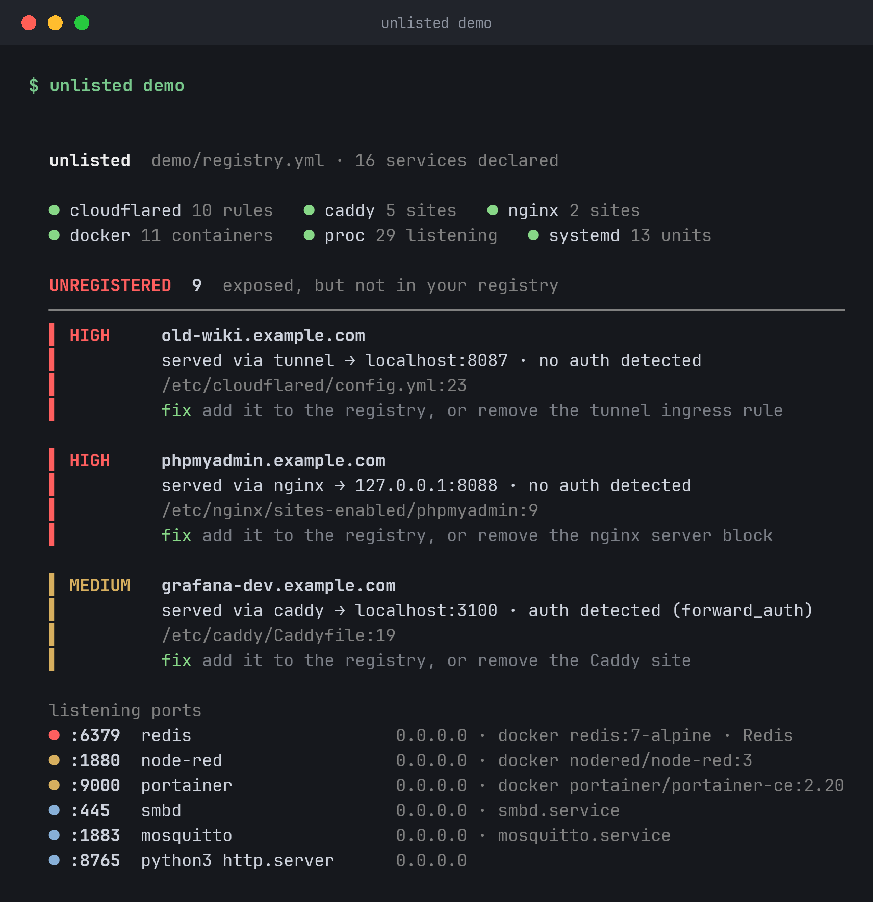

# unlisted

[](https://github.com/kd-011/unlisted/actions/workflows/ci.yml)

Compares the services you say you run with what your machine exposes through Cloudflare Tunnel, Caddy, nginx, Docker and listening ports, and lists where they disagree.



That is real output from `unlisted demo`, which runs against a fake homelab built into the binary. The [full report](docs/demo.png) and a [text copy](docs/demo.txt) are in docs/. The image is made by `make screenshot`.

## Install

```sh
curl -fsSL https://raw.githubusercontent.com/kd-011/unlisted/main/install.sh | sh
```

That downloads the release binary for your OS, checks it against the published checksum and puts it in `~/.local/bin`. It needs no Go. With Go instead: `go install github.com/kd-011/unlisted@latest`. More in [docs/install.md](docs/install.md).

## Try it

```sh
unlisted demo     # the fake homelab, nothing read from your machine
unlisted          # your machine: with no registry.yml it lists everything exposed
unlisted init     # write registry.yml from what it found, then edit it
unlisted          # from now on, only the differences
```

`init` records what is exposed right now, so the check after it is clean and every later change shows up as a finding. Open the file afterwards and fix the names and the `auth:` lines, which `init` can only guess at. Run as root, or with access to the Docker socket, to see everything. Without that it still runs and says which sources it could not read.

## What it finds

| Type | Meaning |
| --- | --- |
| `UNREGISTERED` | Exposed (a tunnel or proxy hostname, or a port bound beyond loopback) but not in your registry. |
| `DEAD` | In the registry, but nothing serves it. |
| `NOAUTH` | Reachable through a tunnel or proxy hostname with no auth detected in front, and none declared. |
| `DRIFT` | The registry port differs from the port the tunnel or proxy sends traffic to. |
| `CERT` | With `--probe`: a TLS certificate that is expired, expiring or not verifying. |

Each finding has a severity, the service, what was found, the file and line it came from and a one-line fix. `NOAUTH` means no auth was detected: it can see a Caddy `forward_auth` or an nginx `auth_basic`, not a login screen inside an app, so declare `auth: app` for those. Details are in [docs/reference.md](docs/reference.md).

The registry is a short YAML list:

```yaml
services:
  - name: Jellyfin
    host: jellyfin.example.com
    port: 8096
    auth: app
```

The fields are in [docs/registry.md](docs/registry.md). `--json` and `--format markdown` give machine-readable and pasteable output, and exit code 1 on findings makes it usable from cron or CI. There is also a [GitHub Action](docs/action.md) for a repo that keeps its Caddyfile and tunnel config together.

It is one static Go binary, read-only, and makes no network calls unless you pass `--probe`. Only `unlisted init` writes a file.

## When not to use it

- To learn what is reachable from the internet. It reads config files and sockets on this machine. It does not see your router, your firewall or a tunnel route set in the Cloudflare dashboard. An nmap scan from outside answers that.
- If your proxy is Traefik or Nginx Proxy Manager. There is no reader for them yet. Docker ports and listening sockets still show up.
- For continuous monitoring. It is a one-shot diff. Run it from cron or CI if you want it repeated, or use an uptime monitor for liveness.
- On Windows, which is untested, or for listening sockets on macOS. Sockets come from `/proc`, so macOS gets the config readers and Docker but no socket list.
- For several machines at once. It reads the machine it runs on, plus config files you point it at.

The full list is in [docs/limitations.md](docs/limitations.md), and how it sits next to ss, nmap, dashboards and uptime monitors is in [docs/alternatives.md](docs/alternatives.md).

## Building

```sh
make test        # vet and tests, race detector on
make build       # ./unlisted, static
make demo        # run the demo
```

Contributing is in [CONTRIBUTING.md](CONTRIBUTING.md). A new discovery source is one file implementing a two-method interface, plus a fixture and a test. The most useful bug report includes a sanitised config snippet. MIT licence, see [LICENSE](LICENSE).
